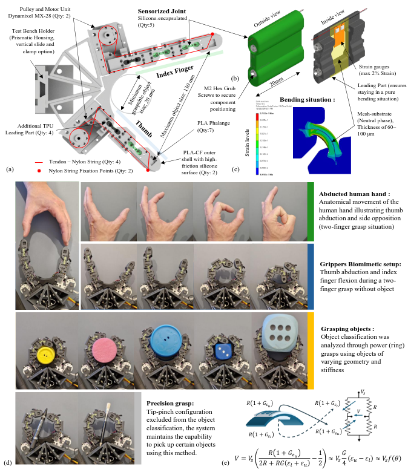

# STIR-Hand

This is the repository for the analysis conducted for the STIR-Hand paper, currently under review. [TODO: Add link to paper and video after publication]. The STIR-Hand is an underactuated, safe, tendon-driven, two-finger robotic hand actuated by two independent motors. 

<p align="center">
  
</p>
<!-- The default markdown statement is , but this does not center the image. -->


The two .ipynb files provide self-contained code for the analysis and results reported in the paper. The file **STIR-Hand-Analysis** provides code for the unsupervised analysis and object classification experiments. The file **STIR-Hand-LSTM** provides an LSTM model for learning the classification task on raw data rather than on extracted features.

---

## Setup

Clone this repository:

```bash
git clone https://github.com/ShubhanPatni/STIR-Hand.git
```

Download all of our data from [this Google Drive link](https://drive.google.com/file/d/1zK8pDIlo_fye2k9pi4qOtWylvG-8nuaA/view?usp=drive_link) and move it to the repository's folder.

The analysis portion requires Python 3.10. [virtualenv](https://virtualenv.pypa.io/en/latest/) is recommended to create a self-contained environment:

```bash
pip install virtualenv
```

Create and activate a virtual environment:

```bash
virtualenv -p /usr/bin/python3.10 STIR-Hand_env
source STIR-Hand_env/bin/activate
```

Install dependencies:

```bash
# CPU only
pip install -r requirements-cpu.txt

# GPU/CUDA (Required for running the LSTM model)
# adjust cu121 to match your driver — check https://pytorch.org/get-started/locally/
pip install -r requirements-cuda.txt
```

Then, navigate to the repository's folder and use the jupyter notebook GUI to explore our data:

```bash
cd STIR-Hand/
jupyter lab
```
